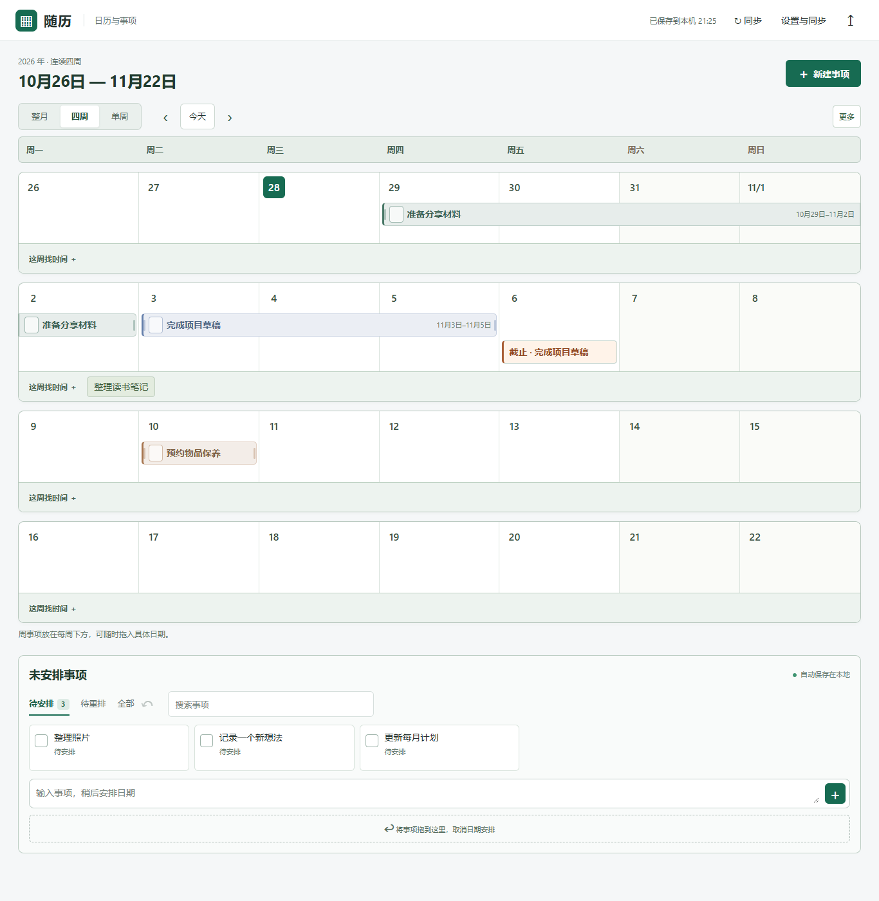
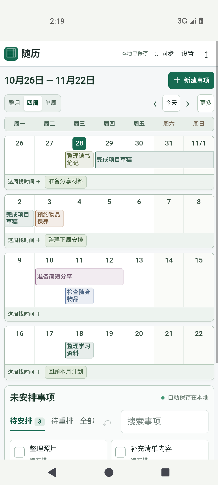
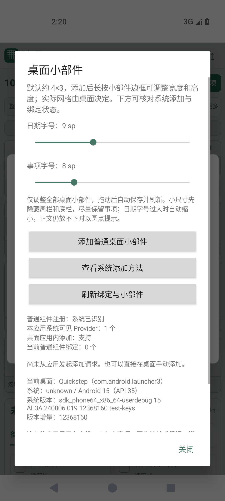
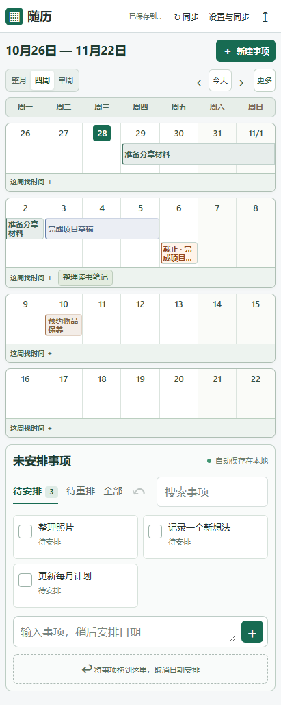

# 随历

**先记下要做的事，再安排到某一天、某一周或一段时间。**

随历是一个本地优先的日历与事项工具，适合尚未确定精确日期的计划。电脑浏览器和 Android 应用共用完整日历界面，支持不连续的多段安排、拖动、拉伸、周事项和独立截止日。未安排事项集中显示在日历下方，Android 另提供可调整大小与字号的桌面小部件。

## 界面预览

电脑、手机浏览器与 Android 应用截图使用虚构示例事项，收录于 2026-10-28。当时仓库中的桌面／网页版本为 **0.4.1**，Android 为 **0.4.2**。当前 **0.5.0** 已加入多段安排，下面保留旧版布局预览。

| 电脑浏览器 | Android 应用（模拟器） |
| --- | --- |
|  |  |

Android 应用与字号设置截图来自 Android 15（API 35）AOSP 模拟器中的实际应用，兼容性范围限于所展示的模拟器环境。

<details>
<summary>查看 Android 小部件与字号设置</summary>

| 小部件静态示意 | 应用内字号设置 |
| --- | --- |
|  |  |

左图来自应用内置的系统小部件选择器预览资源，用于展示静态布局。右图为 Android 0.4.2 的应用内小部件设置界面。实际桌面显示由设备、桌面实现、尺寸和字体共同决定。

</details>

<details>
<summary>查看手机浏览器紧凑布局</summary>



</details>

## 功能

- **日期可以逐步明确**，先保留为待安排，再安排到一天、一周或连续多天。支持整月、连续四周和单周视图。
- **同一事项支持多段安排**，在日历上连续点选或划选不连续时间段，逐段拖动、拉伸和移除。手机支持点选起止日期与跨周选择。
- **每周有独立的“这周找时间”区域**，可先安排到某一周，再细化到具体日期。
- **处理计划和截止日分别保存**，分别提示原计划已过与硬截止逾期。截止标记会自动填入当天最靠上的空位。
- **未安排事项集中显示在日历下方**，支持快速录入、搜索、筛选、批量添加和撤销。
- **Android 内置离线日历界面**，原生同步和小部件使用同一份手机事项历史。支持紧凑／宽松布局与 6–16 px 事项字号。
- **Android 桌面小部件可调整大小**，默认请求约 4×3，支持横向、纵向缩放，日期与事项字号可分别调整。
- **多端同步按需启用**，可自行配置 WebDAV 文件，或连接电脑提供的本地同步服务。并发修改保留版本供用户选择。

## 电脑端快速开始

需要 **Windows 和 Node.js 22 或更新版本**。运行时只使用 Node.js 标准库，取得源码后可直接启动。

在项目根目录运行以下命令。

```powershell
npm start
```

浏览器打开 [http://127.0.0.1:4317](http://127.0.0.1:4317)，保留终端窗口，按 `Ctrl+C` 停止服务。也可使用 Windows 启动器在后台启动并打开页面。

```powershell
.\Start-Calendar.ps1 -Open
```

首次使用、桌面快捷方式、离线操作和双端同步配置见 [使用指南](docs/getting-started.md)。

## Android 从源码构建

准备 **JDK 17、Android SDK API 35** 和对应构建工具，设置 `JAVA_HOME` 与 `ANDROID_HOME`，并接受 SDK 许可。从项目根目录进入 Android 工程，首次构建需要网络以取得依赖。

```powershell
Set-Location android
.\build.ps1 -Online
```

构建产物相对仓库根目录为 `android/app/build/outputs/apk/debug/app-debug.apk`。这是本机开发签名包，升级需要兼容签名，更换签名或重装前请导出备份。完整环境配置、安装和发布签名说明见 [Android 说明](android/README.md)。

## 同步与数据

| 方式 | 适用场景 | 连接方式 |
| --- | --- | --- |
| WebDAV | 手机与电脑跨网络同步，电脑无需一直开机 | 两端配置同一个专用 JSON 文件地址 |
| 本地电脑 | 手机连接正在运行的电脑服务 | 电脑显式开启局域网模式，手机填写地址与连接码 |

事项先保存在当前设备。WebDAV 同步文件和 JSON 备份包含事项内容及操作历史，凭据由各端独立保存。请定期导出备份，尤其在升级、重装和更换签名前。远端文件和导出文件含有私人内容，应控制访问权限。配置 HTTPS 地址可保护传输，远端文件以明文 JSON 保存。

完整配置和恢复步骤见 [使用指南](docs/getting-started.md)，数据位置、权限与凭据处理见 [隐私说明](PRIVACY.md)。

使用多段安排前，请将参与同步的电脑服务与 Android 应用都更新到 **0.5.0 或更新版本**。新版可继续读取原有事项及修改历史。旧客户端会拒绝含多段记录的快照并保留原文件，即使后来取消多段安排，历史中的记录仍需要新版客户端。

## 当前范围

- 桌面／网页与 Android 当前版本均为 **0.5.0**。
- Android 最低声明为 Android 8.0（API 26），实际运行还取决于系统 WebView 与设备环境，需要在目标设备验证。
- 小部件的最终格数、最小尺寸和添加入口由手机桌面决定。**小米小部件中心／负一屏尚待独立接入审核与兼容性验证**。
- 后台同步可能受网络、系统省电和桌面调度延迟。已保存事项可离线使用，进程结束后可能丢失尚未保存的输入或编辑草稿。
- 浏览器需要支持 ES modules、Web Locks 和 Service Worker。电脑端请从本机回环地址打开，同一浏览器一次使用一个编辑标签页。

## 开发与贡献

[开发指南](docs/development.md) 介绍目录结构、测试、Android 构建和签名注意事项。[贡献指南](CONTRIBUTING.md) 说明提交问题和贡献代码的方式。

准备公开源码副本时，可按 [源码导出说明](docs/publishing.md) 检查公开文件、隐私扫描与发布内容。

本项目采用 [Apache License 2.0](LICENSE)。
